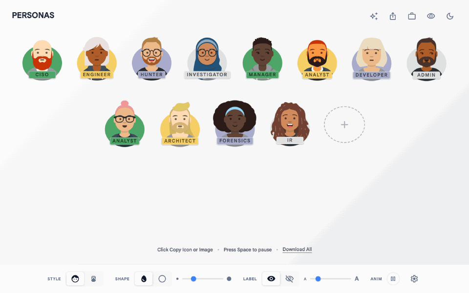
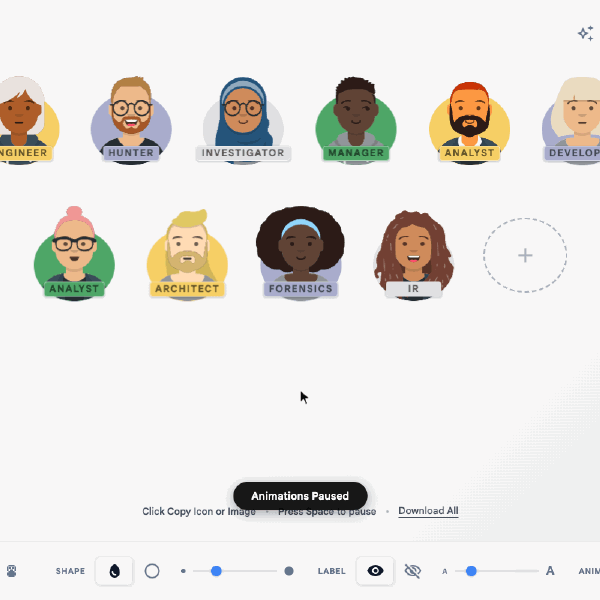
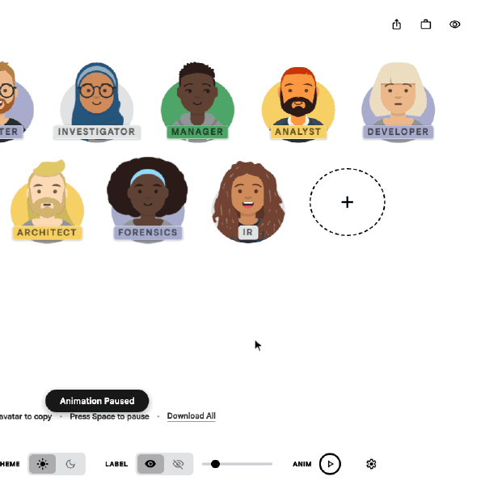
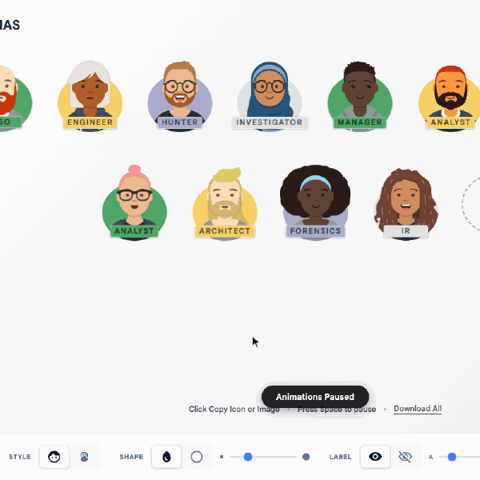
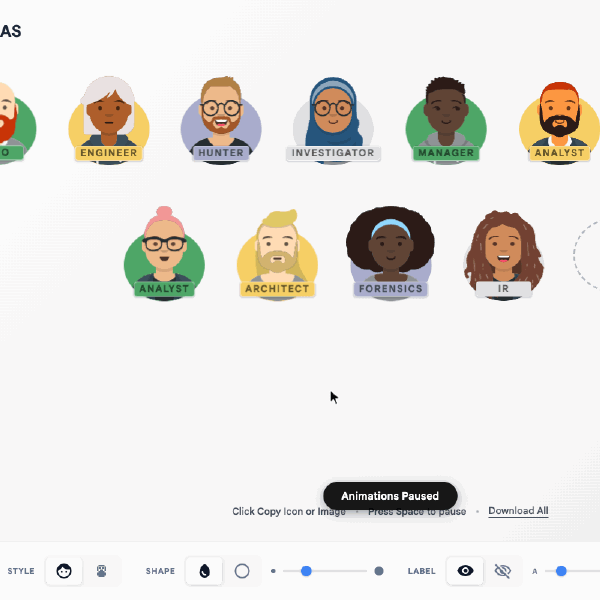
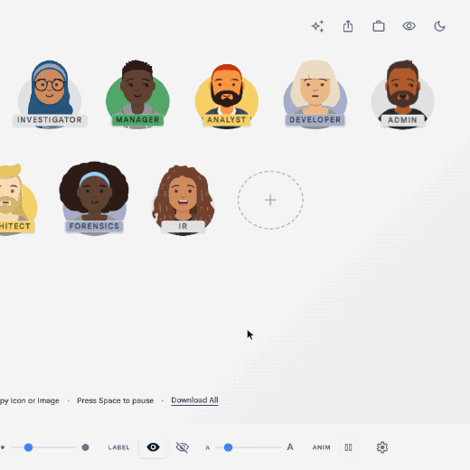

# `peeps`

Illustrated personas for slides and docs. Name them, restyle them, and copy them out as images.

  
[<kbd> haaans.com/peeps  </kbd>](https://haaans.com/peeps/)

## Features

<table>
<tr valign="top">
<td width="50%">
<h3>Copy any persona</h3>

Click a persona to copy it as a PNG. Settings switches the format to SVG, and Download All saves the whole set as a zip.

</td>
<td width="50%">

</td>
</tr>
<tr valign="top">
<td width="50%">

</td>
<td width="50%">
<h3>Add and name personas</h3>

The + button adds a persona and selects its label so you can type a role. The sparkle button can also generate a full set from a description, using your own Gemini API key.

</td>
</tr>
<tr valign="top">
<td width="50%">
<h3>Change the face, color and name</h3>

Hover a persona for buttons to swap the face, cycle the background color, copy it or remove it. Click the label to rename it.

</td>
<td width="50%">

</td>
</tr>
<tr valign="top">
<td width="50%">

</td>
<td width="50%">
<h3>Switch to pixel art</h3>

Pixel style redraws every persona as pixel art, shown full body or head only. Copying and downloading work the same way.

</td>
</tr>
<tr valign="top">
<td width="50%">
<h3>Set the shape and size</h3>

Choose circle or oval backgrounds and resize the whole set at once. Share copies a link to the current set and style.

</td>
<td width="50%">

</td>
</tr>
<tr valign="top">
<td width="50%">

</td>
<td width="50%">
<h3>Party mode and dark mode</h3>

Party mode changes everyone's outfit and adds confetti. The moon icon in the top bar switches to dark mode.

</td>
</tr>
</table>
