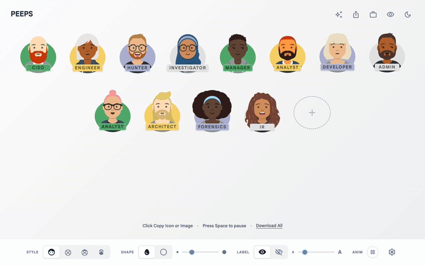
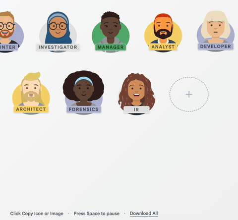
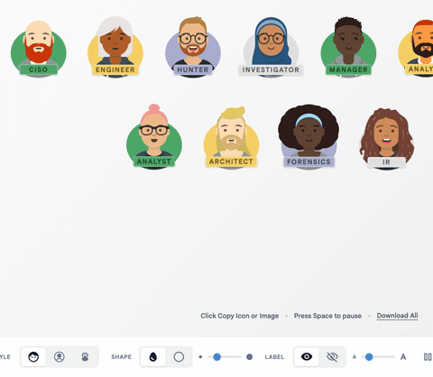
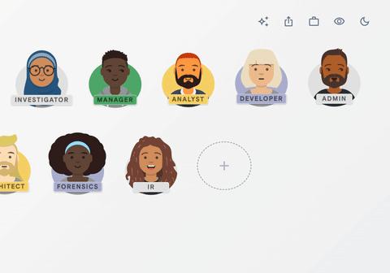

# `peeps`

Quick generate, copy and paste UX personas. Name them, restyle them, and copy them out as images.

  
[<kbd> haaans.com/peeps  </kbd>](https://haaans.com/peeps/)

<a href="demos/hero@zoom.avif">
<picture>
<source media="(min-width: 1024px)" type="image/avif" srcset="demos/hero@2x.avif">
<source type="image/avif" srcset="demos/hero.avif">

</picture>
</a>

## Features

<table>
<tr valign="top">
<td width="50%">
<h3>Copy, add and name personas</h3>

Click a persona to copy it as a PNG. The + button adds one and selects its label so you can type a role, and the sparkle button can generate a whole set from a description, using Chrome's on-device model or your own Gemini API key.

</td>
<td width="50%">
<a href="demos/copyadd@zoom.avif">
<picture>
<source media="(min-width: 1024px)" type="image/avif" srcset="demos/copyadd@2x.avif">
<source type="image/avif" srcset="demos/copyadd.avif">

</picture>
</a>
</td>
</tr>
<tr valign="top">
<td width="50%">
<a href="demos/restyle@zoom.avif">
<picture>
<source media="(min-width: 1024px)" type="image/avif" srcset="demos/restyle@2x.avif">
<source type="image/avif" srcset="demos/restyle.avif">

</picture>
</a>
</td>
<td width="50%">
<h3>Shuffle, or restyle</h3>
</td>
</tr>
<tr valign="top">
<td width="50%">
<h3>Party mode and dark mode</h3>

Party mode changes everyone's outfit and adds confetti. The moon icon in the top bar switches to dark mode.

</td>
<td width="50%">
<a href="demos/party@zoom.avif">
<picture>
<source media="(min-width: 1024px)" type="image/avif" srcset="demos/party@2x.avif">
<source type="image/avif" srcset="demos/party.avif">

</picture>
</a>
</td>
</tr>
</table>
