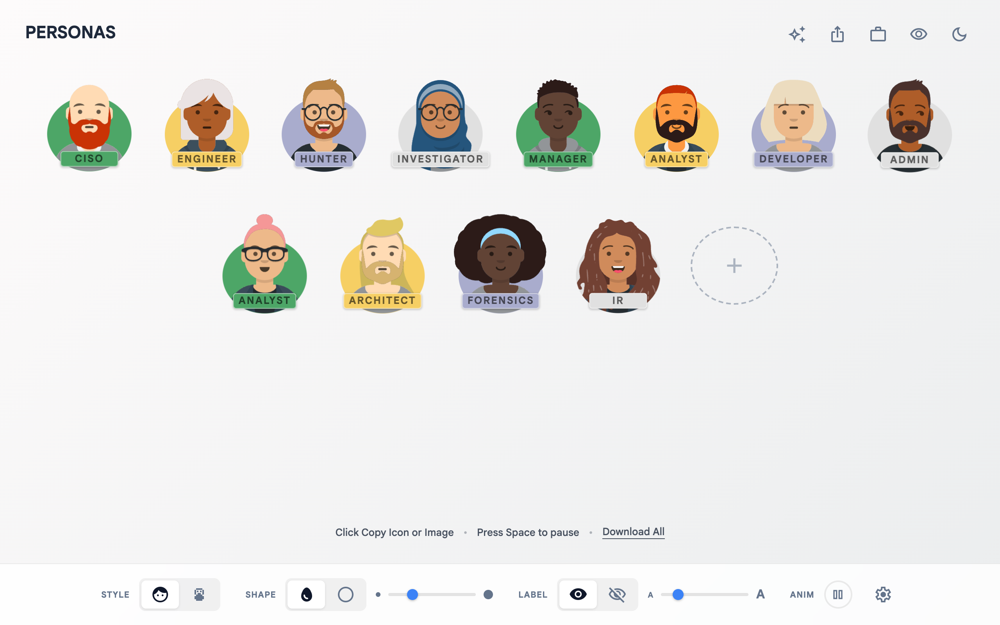

# `peeps`

A lineup of illustrated personas for decks and docs. Rename them, remix them, and paste them straight into your slides.

  
[<kbd> haaans.com/peeps  </kbd>](https://haaans.com/peeps/)

## Features

<table>
<tr valign="top">
<td width="50%">
<h3>Click to copy a PNG</h3>

Click any person and they're on your clipboard, ready to paste into slides or docs. Switch to SVG in settings, or use Download All to get the whole lineup as a zip.

</td>
<td width="50%">

</td>
</tr>
<tr valign="top">
<td width="50%">

</td>
<td width="50%">
<h3>Add someone and name them</h3>

The + adds a new persona with its label already selected, so you can type the role straight away. Or describe a team, and the sparkle button generates a whole lineup using your own Gemini key.

</td>
</tr>
<tr valign="top">
<td width="50%">
<h3>Remix the face, cycle the color</h3>

Hover a person to remix them into someone new, cycle their background color, copy them, or remove them.

</td>
<td width="50%">

</td>
</tr>
<tr valign="top">
<td width="50%">

</td>
<td width="50%">
<h3>Go pixel</h3>

Turn the whole lineup into pixel peeps, then switch between full body and just heads. Copy and download work the same way.

</td>
</tr>
<tr valign="top">
<td width="50%">
<h3>Party mode, day or night</h3>

Same team in party outfits, with confetti. The moon in the top corner switches everything to night.

</td>
<td width="50%">

</td>
</tr>
<tr valign="top">
<td width="50%">

</td>
<td width="50%">
<h3>Reshape the whole lineup</h3>

Choose circles or ovals at any size. Share copies a link to the exact lineup and style.

</td>
</tr>
</table>
